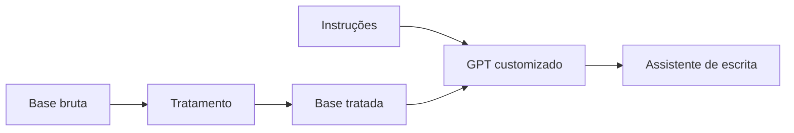

<p align="center">

</p>

<h1 align="center">GPT Customizado</h1>
<p align="center"><i>Assistente de escrita criado como GPT especializado no bootcamp da DIO</i></p>

<p align="center">


</p>

## Sumário

- [Sobre](#sobre)
- [O que foi praticado](#o-que-foi-praticado)
- [Como visualizar](#como-visualizar)
- [Estrutura do repositório](#estrutura-do-repositório)
- [Autor](#autor)

## Sobre

Case prático do **bootcamp da DIO**: criar e configurar um **GPT customizado** no ChatGPT, com instruções próprias, base de conhecimento e tom de comunicação definidos, para atuar como **assistente de escrita**.

## O que foi praticado

| Pasta | Conceito |
| --- | --- |
| `Base_Bruta/` | Exemplos de conteúdo de entrada, antes do tratamento |
| `Base_Tratada/` | Conteúdo organizado para servir de conhecimento ao GPT |
| `Scripts/` | Instruções do que o GPT deve fazer |



## Como visualizar

Os arquivos documentam a configuração do GPT. Para reproduzir, crie um GPT no ChatGPT (*Explore GPTs → Create*), use as instruções de `Scripts/` e envie os arquivos de `Base_Tratada/` como conhecimento.

## Estrutura do repositório

```text
Projeto-GPT-DIO/
├── Base_Bruta/
├── Base_Tratada/
├── Scripts/
└── assets/capa.png
```

## Autor

**Saulo Prado** · Analista de Sistemas · Gestão de Ativos de TI, orçamento, automação e dashboards

[](https://www.linkedin.com/in/saulo-prado-ab4a0b96/)
[](https://github.com/sauloprado)
